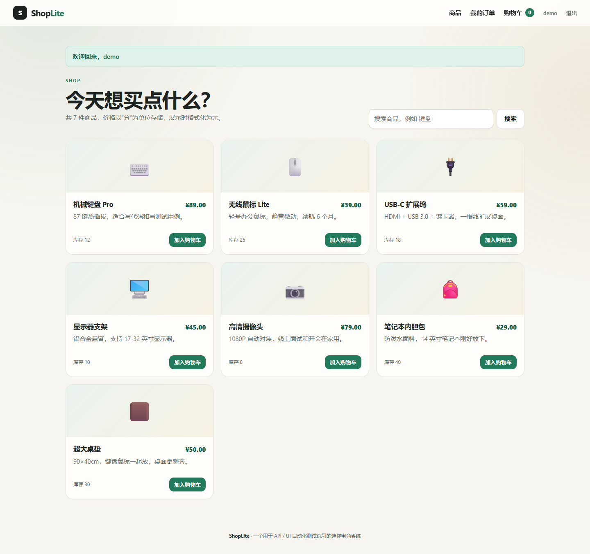
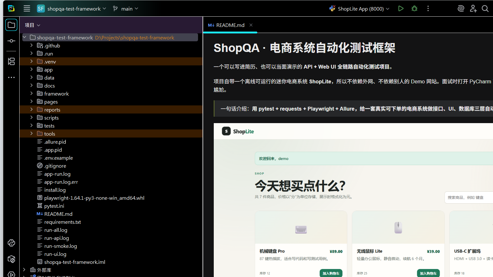
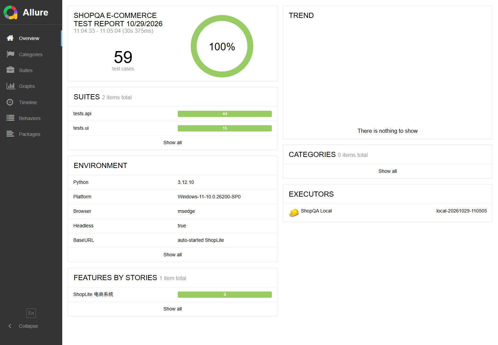
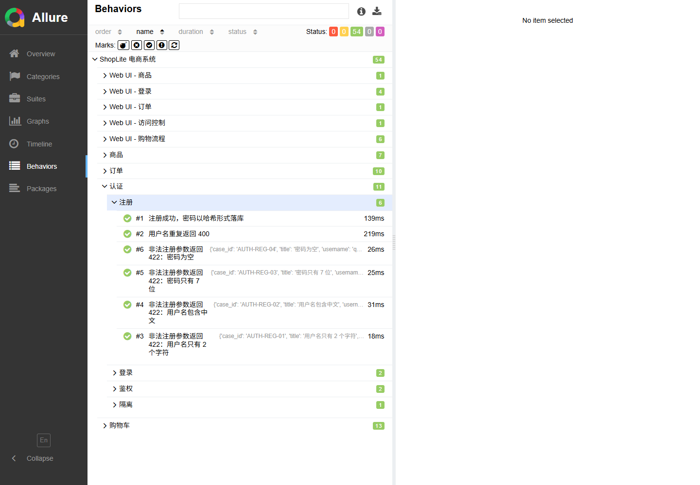

# ShopQA · 电商系统自动化测试框架

一个可以写进简历、也可以当面演示的 **API + Web UI 全链路自动化测试项目**。

项目自带一个离线可运行的迷你电商系统 **ShopLite**，所以不依赖外网、不依赖别人的 Demo 网站。面试时打开 PyCharm 就能跑，不会出现“在我电脑上能跑”的尴尬。

> 一句话介绍：**用 pytest + requests + Playwright + Allure，给一套真实可下单的电商系统做接口、UI、数据库三层自动化测试。**



*被测系统实际页面：搜索、加购、库存、价格都由后端真实计算。*

---

## 1. 这个项目为什么能写进简历

很多同学的“自动化测试项目”只有几个 `requests.get()` 断言，面试官一问就露馅。这个项目把测试岗最常问的几件事都串起来了：

| 招聘方关心 | 这个项目里的落点 |
|---|---|
| 测试用例设计能力 | 正常流、异常流、边界值、权限隔离、库存边界、优惠券门槛 |
| 接口自动化 | requests 封装、token 管理、JSON Schema 契约校验、数据驱动 |
| UI 自动化 | Playwright、Page Object、`data-testid`、失败截图、显式等待 |
| 测试数据隔离 | 每个用例独立用户、每个会话临时 SQLite，互不污染 |
| 数据库校验 | 不只看接口返回，还查订单、明细、库存是否真的落库 |
| 持续集成 | GitHub Actions 自动安装、跑测试、上传 Allure 报告 |
| 工程化 | 配置与代码分离、日志、报告、运行脚本、测试文档 |

**不是“我学过 pytest”，而是“我独立设计并实现了一套能跑的测试框架”。**

---

## 2. 技术栈

- Python 3.12
- 被测系统：FastAPI + Jinja2 + SQLite
- 接口测试：pytest + requests + JSON Schema + PyYAML
- UI 测试：Playwright（Chromium / 本机 Edge）
- 报告：Allure
- CI：GitHub Actions

---

## 3. 目录结构

```text
shopqa-test-framework/
├── app/                         # 被测系统 ShopLite（不是测试代码）
│   ├── main.py                  # 页面路由 + JSON API
│   ├── db.py                    # SQLite 建表、种子数据、密码哈希
│   ├── templates/               # 登录、商品、购物车、结算、订单页面
│   └── static/style.css
├── framework/                   # 测试框架的公共层
│   ├── api_client.py            # requests 封装：token、日志、Allure 附件
│   ├── assertions.py            # 状态码、子集、JSON Schema 断言
│   ├── schemas.py               # 接口契约
│   ├── config.py                # 环境配置
│   ├── db.py                    # 测试侧数据库查询
│   ├── data.py                  # YAML 数据加载
│   └── logger.py
├── pages/                       # Page Object
│   ├── base_page.py
│   ├── login_page.py
│   ├── products_page.py
│   ├── cart_page.py
│   ├── checkout_page.py
│   ├── order_detail_page.py
│   └── orders_page.py
├── tests/
│   ├── conftest.py              # 启动服务、浏览器、用户、登录态 fixture
│   ├── api/                     # 41 条接口用例
│   ├── ui/                      # 13 条 UI 用例
│   └── helpers.py
├── data/                        # YAML 测试数据
├── docs/                        # 测试计划、用例、讲解、简历写法
├── scripts/                     # 一键运行 / 生成报告
├── .run/                        # PyCharm 运行配置
├── .github/workflows/tests.yml  # CI
├── pytest.ini
└── requirements.txt
```

---

## 4. 五分钟跑起来

### 4.1 打开项目

PyCharm 打开：

```text
D:\Projects\shopqa-test-framework
```

解释器选择：

```text
D:\Projects\shopqa-test-framework\.venv\Scripts\python.exe
```

如果右上角没有运行配置，`File → Reload from Disk`，或者右键 `tests` 目录直接运行 pytest。



### 4.2 命令行运行

```powershell
Set-Location D:\Projects\shopqa-test-framework
.\.venv\Scripts\python.exe -m pytest
```

第一次运行会自动：

1. 在随机端口启动 ShopLite；
2. 建一个临时 SQLite 数据库并写入演示数据；
3. 跑完接口和 UI 用例；
4. 关闭服务和浏览器；
5. 把结果写进 `reports/allure-results/`。

### 4.3 只跑某一类

```powershell
# 只跑冒烟
.\.venv\Scripts\python.exe -m pytest -m smoke

# 只跑接口
.\.venv\Scripts\python.exe -m pytest tests/api

# 只跑 UI
.\.venv\Scripts\python.exe -m pytest tests/ui

# 跑某个文件
.\.venv\Scripts\python.exe -m pytest tests/api/test_orders.py -v
```

### 4.4 看 Allure 报告

```powershell
.\scripts\report.ps1
# 想直接启动本地报告服务并打开浏览器：
.\scripts\report.ps1 -Serve
```

如果 `tools\allure-2.29.0` 不存在，脚本会提示安装方式；也可以直接用：

```powershell
allure serve reports\allure-results
```



*54 条用例全部通过，报告里能看到 41 条接口 + 13 条 UI 的分组。*

### 4.5 在 Allure 里看参数化用例的标题

`@allure.title("非法注册参数返回 422：{case[title]}")` 这 4 条用例不在 Overview 里逐条显示，要按功能层级找：

```text
Behaviors（行为）
  → ShopLite 电商系统
    → 认证
      → 注册
```

展开后就能看到 4 条不同的标题：

```text
非法注册参数返回 422：用户名只有 2 个字符
非法注册参数返回 422：用户名包含中文
非法注册参数返回 422：密码只有 7 位
非法注册参数返回 422：密码为空
```



标题右边的 `{'case_id': 'AUTH-REG-01', ...}` 是 pytest 自动带出的参数值，不是报错。

---

## 5. 手工体验被测系统

```powershell
Set-Location D:\Projects\shopqa-test-framework
.\.venv\Scripts\python.exe -m uvicorn app.main:app --reload --port 8000
```

浏览器打开 <http://127.0.0.1:8000>。

演示账号：

```text
demo / Demo123!
```

可以看到：登录 → 商品搜索 → 加入购物车 → 修改数量 → 用 `QA10` 优惠券 → 下单 → 我的订单。

接口文档：<http://127.0.0.1:8000/docs>

---

## 6. 测试设计

### 6.1 业务规则

| 规则 | 说明 |
|---|---|
| 注册 | 用户名 3–30 位，只允许字母/数字/下划线；密码至少 8 位 |
| 登录 | 成功返回 Bearer token，同时支持浏览器 HttpOnly Cookie |
| 购物车 | 同一商品重复加入会累加数量；数量 1–99；不能超过库存 |
| 优惠券 | `QA10`：商品小计满 ¥100.00 减 10%，不满返回 400 |
| 下单 | 再次校验库存；写订单和订单明细；扣库存；清空购物车 |
| 权限 | 用户只能看自己的购物车和订单；改 URL 也不能越权 |
| 金额 | 全部用“分”存整数，避免浮点精度问题 |

### 6.2 覆盖矩阵

| 层级 | 覆盖点 |
|---|---|
| 接口 | 注册、登录、鉴权、商品列表/详情/搜索、购物车增删改查、库存、优惠券、订单、越权、参数校验、数据库落库 |
| UI | 登录成功/失败、未登录拦截、搜索、加购、改数量、移除、空购物车、优惠券门槛、完整下单、订单历史、订单越权 |
| 契约 | 登录、用户、商品、购物车、订单、错误响应 JSON Schema |
| 数据 | YAML 参数化；每个用例随机用户；会话级临时数据库 |

详细用例见 [docs/测试用例.md](docs/测试用例.md)，测试策略见 [docs/测试计划.md](docs/测试计划.md)。

---

## 7. 关键设计，面试可以展开讲

### 7.1 为什么自己写被测系统

- 公开 Demo 网站会挂、会改版、会限流，面试当天跑不起来很致命；
- 自己写的最小系统可以精确控制业务规则，才能设计“刚好 100 元”的边界用例；
- 可以同时验证 API、UI、SQLite，讲清楚“接口通过 ≠ 数据正确”。

### 7.2 分层

```text
测试用例：只写业务动作和断言
    ↓
Page Object / ApiClient：封装操作细节
    ↓
pytest fixture：准备服务、用户、浏览器、登录态
    ↓
被测系统 / SQLite
```

测试用例里不出现 `requests.get`、CSS 选择器、数据库连接串；这些都在公共层。

### 7.3 稳定性处理

- UI 用 `data-testid`，不依赖样式和 DOM 层级；
- Playwright 自动等待 + 页面对象里显式等待 URL/元素；
- 每个用例独立用户 + 独立浏览器 Context，避免 Cookie 和购物车串数据；
- 服务只启动一次，数据库用临时文件，跑完即销毁；
- 失败自动截图 + 保存页面 HTML 到 Allure。

### 7.4 数据驱动

`data/api_cases.yaml` 放注册异常、优惠券规则；`data/product_cases.yaml` 放搜索用例。改数据不用改代码。

### 7.5 断言层次

1. 状态码；
2. 关键字段（子集断言）；
3. 完整结构（JSON Schema）；
4. 数据库（订单、明细、库存）；
5. UI（用户真正看到的文案和金额）。

---

## 8. CI

`.github/workflows/tests.yml` 在 push / PR 时：

1. 安装 Python 依赖；
2. 安装 Chromium；
3. 跑全部 pytest；
4. 上传 Allure 结果；
5. 生成并发布 Allure 报告（GitHub Pages）。

本地不配 CI 也能完整运行。

---

## 9. 学习与面试材料

- [项目讲解：从零是怎么写出来的](docs/项目讲解.md)
- [测试计划](docs/测试计划.md)
- [测试用例](docs/测试用例.md)
- [简历写法与面试问答](docs/简历写法.md)
- [缺陷管理模板](docs/缺陷管理.md)

---

## 10. 已知限制（面试时主动说，反而加分）

- ShopLite 是测试练习系统，不是生产级电商；没有支付、并发扣库存、分布式事务。
- 没有接 MySQL/Redis，数据库断言用 SQLite；换 MySQL 只需改连接层。
- UI 用例目前覆盖 Chromium/Edge，没有做 Safari/Firefox 兼容性矩阵。
- 没有做性能测试和安全测试，这两块是下一步扩展方向。
- 同步执行，没有任务队列；用例量特别大时应接 pytest-xdist 或 CI 分片。

---

## 11. 下一步可以怎么扩

1. 把数据层从 SQLite 换成 MySQL，补事务和并发扣库存测试；
2. 加 `pytest-xdist` 做接口用例并行；
3. 加 Locust 做下单接口的轻量性能测试；
4. 加 Dockerfile / docker-compose，一条命令起服务和测试；
5. 接 Jenkins 或 GitLab CI，补企业里常见的流水线经验。

---

## 12. 说明

- 所有账号、商品、订单都是本地演示数据，不包含任何公司或真实用户信息。
- 项目里的业务规则是为了练习测试设计而设计的，不代表真实电商的全部规则。
